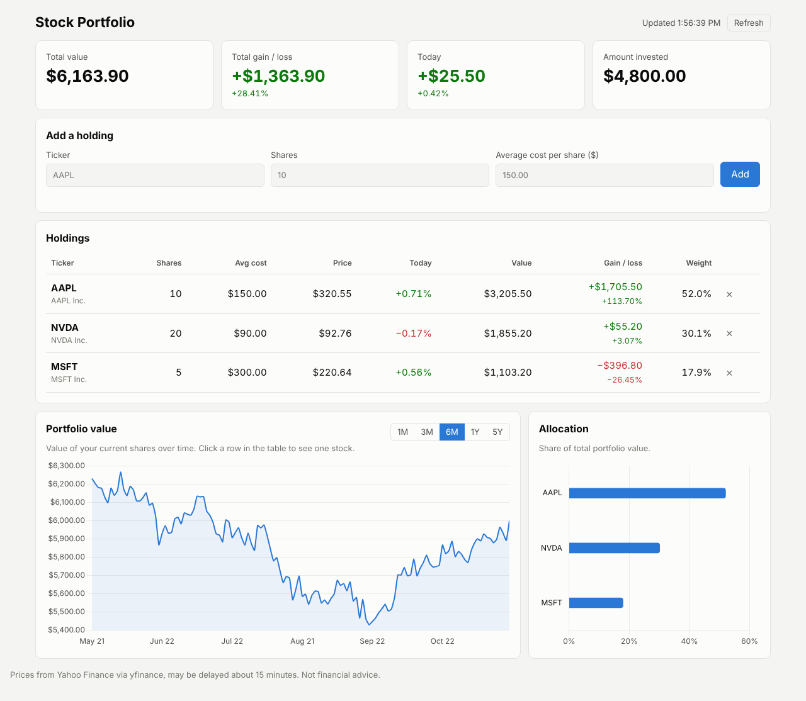

# Stock Portfolio Dashboard

A simple personal dashboard for tracking US stock holdings. Add the stocks you own, and it shows live prices, today's move, total value, gain or loss on each position, a portfolio value chart and your allocation.

Prices come from Yahoo Finance through the [yfinance](https://github.com/ranaroussi/yfinance) library, so no API key or account is needed. Quotes can be delayed by about 15 minutes.



## Features

- Add holdings by ticker, number of shares and average cost per share. Adding the same ticker again merges it into one position with a weighted average cost.
- Totals for portfolio value, amount invested, total gain or loss, and today's change.
- Holdings table with price, today's % change, value, gain or loss ($ and %) and weight.
- Portfolio value chart over 1M, 3M, 6M, 1Y or 5Y. Click a row to see that stock's price chart instead.
- Allocation chart showing each position's share of the portfolio.
- Prices refresh every 60 seconds. Light and dark mode follow your system setting.
- Your holdings are saved in `holdings.json` on your computer and never leave it.

## Run it

You need Python 3.9 or newer.

```bash
git clone https://github.com/ibrahimabdulrazzak/stock-dashboard.git
cd stock-dashboard
python3 -m venv .venv
source .venv/bin/activate        # Windows: .venv\Scripts\activate
python -m pip install -r requirements.txt
python app.py
```

Then open http://127.0.0.1:5000 in your browser.

### Try it with fake prices

To try the dashboard without an internet connection, start it in demo mode. It generates made-up prices.

```bash
STOCK_DEMO=1 python app.py                       # macOS / Linux
set STOCK_DEMO=1 && python app.py                # Windows cmd
```

### Settings

| Variable | Default | What it does |
|---|---|---|
| `PORT` | `5000` | Port the server listens on |
| `HOLDINGS_FILE` | `holdings.json` | Where your holdings are saved |
| `STOCK_DEMO` | off | Set to `1` for fake prices |

## How it works

- `app.py` is a small Flask server. It stores holdings and has a JSON API: `GET/POST /api/holdings`, `PUT/DELETE /api/holdings/<TICKER>`, `GET /api/quotes?symbols=AAPL,MSFT` and `GET /api/history?symbol=AAPL&range=6mo`. Prices are cached for 60 seconds.
- `static/` holds the web page (`index.html`, `style.css`, `app.js`). Charts use Chart.js from a CDN.

The server only listens on your own computer (127.0.0.1), so nobody else on your network can see it.

## Disclaimer

This is a personal tracking tool, not financial advice. Check prices with your broker before making decisions.
